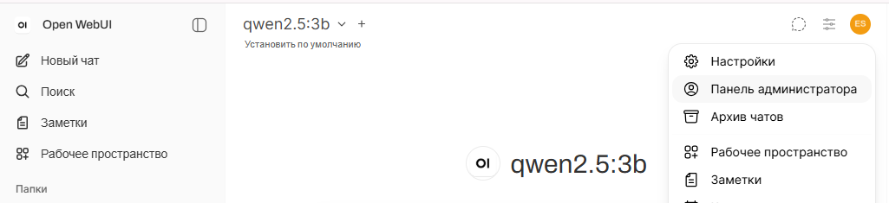
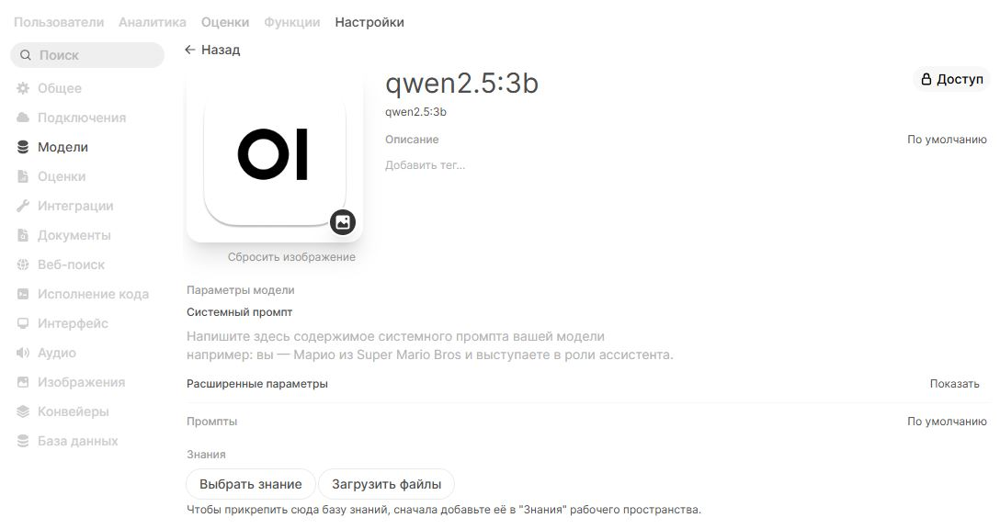
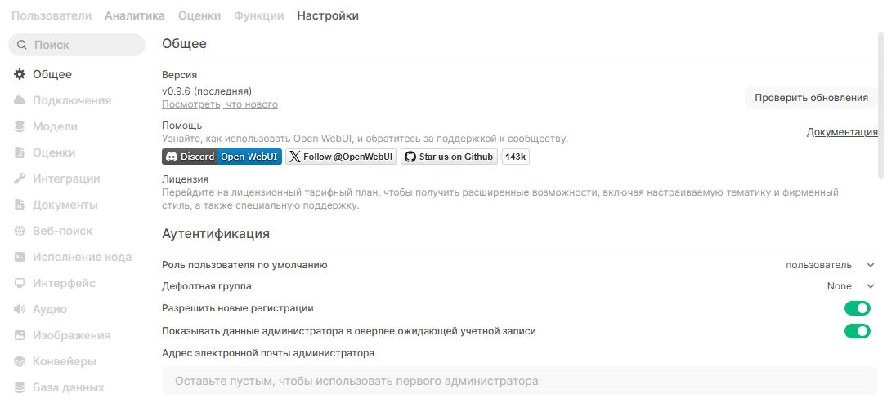

# Локальная LLM: установка на сервер, настройка графического интерфейса

Инструкция постепенно дополняется. Последнее обновление 26 ноября 2026 года.

Инструменты, которые описываются в данной инструкции, не единственные в своем роде. Но принцип работы с локальными LLM в целом один и тот же. 

## Содержание
- [Введение](#введение)
- [Локальный компьютер](#локальный-компьютер)
  - [Ubuntu](#ubuntu)
  - [Windows](#windows)
    - [Ollama](#ollama)
- [Сервер (Ubuntu)](#сервер-(ubuntu))
  - [Ollama](#ollama)
  - [Docker](#docker)
  - [OpenWebUI](#openwebui)
  - [Веб-интерфейс: регистрация администратора](#веб-интерфейс:-регистрация-администратора)
  - [Веб-интерфейс: регистрация пользователей](#веб-интерфейс:-регистрация-пользователей)

---

## Введение
Здесь приводится краткая инструкция по установке локальной LLM на сервер или персональный компьютер.

Развёртывание LLM на собственном компьютере или сервере имеет следующие преимущества:
- конфиденциальность данных: все запросы не отправляются на удалённый сервер, а остаются на вашем компьютере/сервере,
- независимость от интернет-подключения: LLM на вашем ПК будет доступна даже в отсутствие доступа к интернету,
- независимость от ограничений доступа к удалённым серверам: доступ к локальной LLM не зависит от блокировок сайтов;
- отсутствие платных подписок: вы не платите за запросы к API LLM,</li>
- гибкость настроек: локальную LLM можно дообучить для решения конкретного типа задач.</li>

Однако локальные LLM требуют достаточно больших вычислительных мощностей, в идеале — GPU. Такие компьютеры обычно недоступны рядовым пользователям, но некоторые LLM с относительно небольшим числом параметров можно запустить и на CPU при условии достаточного объёма оперативной памяти. Такие модели будут уступать полноценным большим LLM типа новейших версий Gemini или Qwen, но для ряда задач их может оказаться достаточно, особенно при условии их дообучения.

Для развёртывания локальной LLM можно использовать обычный персональный компьютер или сервер ("личный" или арендованный). При установке локальной LLM на ПК она будет доступна только с этого ПК. Если есть необходимость обеспечить удалённый и постоянный доступ к LLM для широкого круга пользователей, лучшим решением будет установка LLM на сервер.

## Локальный компьютер
Небольшие LLM можно запустить даже на обычном ПК со средними характеристиками. Преимуществом установки LLM на локальный компьютер будет независимость от подключения к интернету (оно потребуется только для загрузки необходимого ПО и непосредственно LLM) и работа LLM в полностью изолированной среде: все запросы к LLM остаются на вашем компьютере, LLM не будет подключаться к интернету, чтобы дать ответ на заданный вопрос (если только целенаправленно не "открыть" ей выход в сеть).

Если вам интересно попробовать запустить локальную LLM, но вы не хотите арендовать (или поднимать собственный) сервер, не планируете делиться доступом к LLM с другими пользователями и предполагаете использовать эту LLM только на одном устройстве, то установка LLM на локальный ПК - ваш выбор.

### Ubuntu
Раздел в стадии наполнения.

#### Ollama
...


### Windows
Раздел в стадии наполнения.

#### Ollama
...


### Сервер (Ubuntu)
Если вы планируете делиться доступом к LLM с другими пользователями и хотите сделать свой сайт с графическим интерфейсом для взаимодействия с вашей LLM, то лучшим вариантом станет установка LLM на сервер. 

При наличии подходящих комплектующих можно организовать работу своего личного сервера (который будет "физически" принадлежать вам). (По сути, сервер — это всего лишь компьютер, который круглосуточно включён в сеть и готов отвечать на запросы с устройств-"клиентов".) Однако на практике это не всегда удобно, поэтому серверы чаще арендуют у компаний-провайдеров. (А если вдруг у вас есть собственный сервер — скорее всего, эта инструкция вам уже не нужна.)

Для аренды сервера достаточно выбрать провайдера (Hostiman, RUVDS, ...), зарегистрироваться на его сайте, выбрать конфигурацию сервера и оплатить доступ. По состоянию на июнь 2026 года аренда сервера с перечисленными выше характеристиками стоит 3-4 тысячи рублей в месяц; чем лучше характеристики сервера, тем выше стоимость.

Можно арендовать сервер и с ОС Windows, но для большинства задач (не только связанных с локальными LLM) удобнее Linux.

Доступ к арендованному серверу осуществляется по протоколу SSH через командную строку. Вам потребуется установить на свой ПК c Windows SSH-клиент (например, PuTTY), и у вас появится доступ к терминалу сервера: вы сможете писать там команды, как при работе с обычным ПК с Linux.

Данная инструкция написана на основе опыта развёртывания локальной LLM на сервере со следующей конфигурацией:
- Ubuntu 24.04 LTS,
- 8 ГБ RAM,
- 60 ГБ дискового пространства,
- CPU 4x2.2 ГГц.

Для работы с LLM это очень скромные характеристики, однако этого достаточно, чтобы получить рабочую локальную LLM (пусть и "глуповатую") с графическим интерфейсом. 

#### Ollama

Итак, вы арендовали сервер с Ubuntu или собрали ПК с аналогичными характеристиками. Для начала установим Ollama — программу с открытым исходным кодом, которая предназначена для локального запуска различных LLM. 

Перед установкой обновим индексы пакетов и систему:

```bash
sudo apt update && sudo apt upgrade -y
```

Устанавливаем Ollama:

```bash
curl -fsSL https://ollama.com/install.sh | sh
```

После установки появится предупреждение: ```No NVIDIA/AMD GPU detected. Ollama will run in CPU-only mode```. Это нормально, в нашей конфигурации сервера действительно нет GPU, поэтому LLM будет работать на CPU.

Загрузим и запустим модель qwen2.5:3b. Это небольшая модель, которая "понимает" русский язык и будет работать на 8 ГБ RAM:

```bash
ollama run qwen2.5:3b
```

После загрузки Ollama предложит написать сообщение. Напишите что-нибудь для проверки, дождитесь ответа и нажмите ```Ctrl+D``` для выхода. Итак, Ollama установлена.

Теперь разрешим Ollama принимать подключения со всех адресов, чтобы впоследствии программа, которая будет отвечать за веб-интерфейс, могла взаимодействовать с LLM.

Откройте файл конфигурации Ollama:

```bash
sudo systemctl edit ollama.service
```

Вставьте эти строки между блоками ```### Everything between this...``` и ```### Lines below this...```:
```
[Service]
Environment="OLLAMA_HOST=0.0.0.0"
Environment="OLLAMA_ORIGINS=*"
```
                
Сохраните файл (в редакторе nano это команды: ```Ctrl + O```, затем ```Enter```, затем выход ```Ctrl + X```). Проследите, чтобы файл сохранился под именем ```ollama.service```, а не каким-то другим, и в исходной директории. 

Перезапустите службу Ollama, чтобы применить настройки:
```bash
sudo systemctl daemon-reload
sudo systemctl restart ollama
```

#### Docker

Чтобы "общаться" с установленной нами LLM через привычный графический интерфейс с чатом, мы воспользуемся готовым веб-интерфейсом OpenWebUI. Для его запуска нам потребуется Docker. Установим его по инструкции с [официального сайта](https://docs.docker.com/engine/install/ubuntu/).

Удалим возможные конфликтующие пакеты:
```bash
sudo apt remove $(dpkg --get-selections docker.io docker-compose docker-compose-v2 docker-doc podman-docker containerd runc | cut -f1)
```

Настраиваем apt-репозиторий:

```bash
sudo apt update
sudo apt install ca-certificates curl
sudo install -m 0755 -d /etc/apt/keyrings
sudo curl -fsSL https://download.docker.com/linux/ubuntu/gpg -o /etc/apt/keyrings/docker.asc
sudo chmod a+r /etc/apt/keyrings/docker.asc
sudo tee /etc/apt/sources.list.d/docker.sources &lt;&lt;EOF
Types: deb
URIs: https://download.docker.com/linux/ubuntu
Suites: $(. /etc/os-release && echo "${UBUNTU_CODENAME:-$VERSION_CODENAME}")
Components: stable
Architectures: $(dpkg --print-architecture)
Signed-By: /etc/apt/keyrings/docker.asc
EOF
sudo apt update
```
                    
Устанавливаем пакеты:

```bash
sudo apt install docker-ce docker-ce-cli containerd.io docker-buildx-plugin docker-compose-plugin
```

Убеждаемся, что Docker запустился после установки:

```bash
sudo systemctl status docker
```

Если не запустился, то запускаем принудительно:

```bash
sudo systemctl start docker
```
   
Включаем автозапуск Docker при запуске сервера:

```bash
sudo systemctl enable --now docker
```

#### OpenWebUI

Загрузим и запустим docker-контейнер OpenWebUI:

```bash
sudo docker run -d -p 3000:8080 --add-host=host.docker.internal:host-gateway -v open-webui:/app/backend/data --name open-webui --restart always ghcr.io/open-webui/open-webui:main
```

Теперь на нашем сервере запущен веб-интерфейс, который может взаимодействовать с развёрнутой LLM. 

#### Веб-интерфейс: регистрация администратора

На вашем ПК (не на сервере!) в адресной строке браузера введите:

```http://IP_АДРЕС_ВАШЕГО_СЕРВЕРА:3000```

Откроется страница с формой регистрации. Заполните требуемые поля и войдите в аккаунт. Откроется графический интерфейс с чатом. Первый пользователь, который регистрируется на этой странице, автоматически становится администратором. Администратор может управлять установленными LLM, дополнительно обучать их, задавать системные промпты, видеть статистику запросов и управлять регистрацией и правами новых пользователей. 

В рабочем поле наверху слева кликнике на меню выбора языковой модели и выберите установленную нами qwen2.5:3b. Введите вопрос в поле ввода, дождитесь ответа. Готово! Вы общаетесь с LLM, установленной локально на вашем сервере. 


Если вдруг доступных моделей в меню выбора нет, кликните по кружку с инициалами пользователя наверху справа и в выпадающем меню выберите "Панель администратора". Зайдите на вкладку "Настройки", слева выберите раздел "Модели" и включите qwen2.5:3b. Заодно сразу нажмите на иконку карандаша рядом с названием модели и в открывшемся окне выберите "Публичное" в настройках доступа: тогда эта модель станет доступна не только администратору, но и всем остальным пользователям, которые зарегистрируются впоследствии. 





Обратите внимание, что в настройках модели вы также можете задать системный промпт и загрузить базу знаний, что позволит более точно настроить LLM для решения ваших задач. 

В панели администратора зайдите на вкладку "Настройки" и в разделе "Аутентификация" включите регистрацию новых пользователей и настройте для них роль по умолчанию ("ожидающий", если требуется подтверждение регистрации администратором, и "пользователь", если ручное подтверждение не требуется, — тогда каждый новый пользователь сразу после регистрации сможет начать пользоваться LLM).




#### Веб-интерфейс: регистрация пользователей

После перечисленных действий любой человек может перейти по тому же адресу и зарегистрироваться в качестве нового пользователя. Ему будет доступен тот же графический интерфейс, но с меньшими правами. Администратор будет иметь доступ к истории чатов пользователей и статистике по числу запросов к LLM.

Поскольку LLM установлена на сервере, эта веб-страница будет доступна всегда, когда включён сервер (это обеспечивается провайдером) и на нём запущены служба Ollama и веб-интерфейс (это мы настроили самостоятельно на этапе установки ПО на сервер). В случае очень большого числа запросов от пользователей время ответов LLM может увеличиваться, поскольку возрастёт нагрузка на сервер. Но на практике локальные LLM обычно используются небольшим числом пользователей, которые при обычных сценариях использования LLM не смогут создать нагрузку на сервер, достаточную для ощутимого замедления работы модели. 